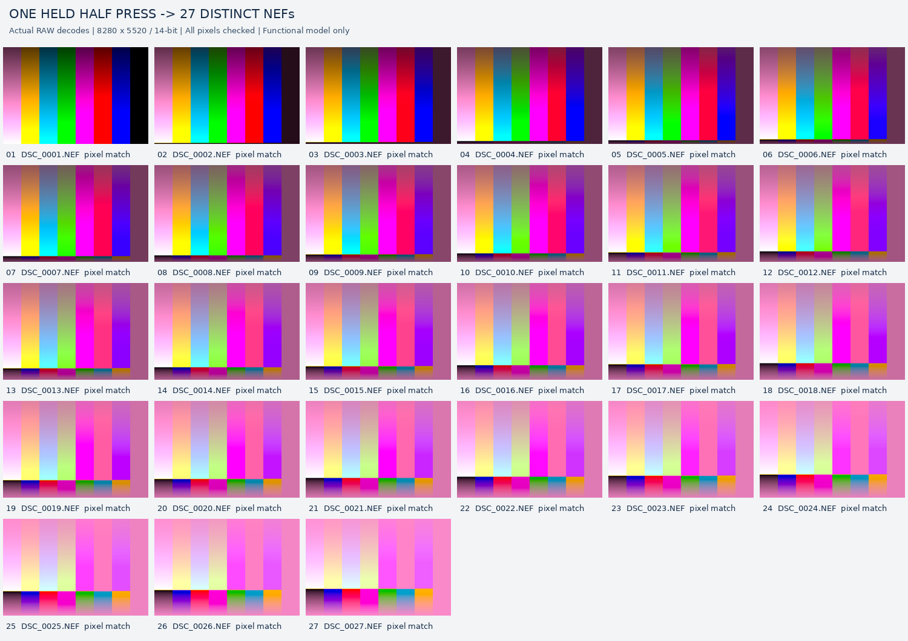

# Nikon Z8：半按触发原生 NEF 的功能模型研究

**当前结果仅限固定的 QEMU 功能模型。没有真机验证，没有证明 10 fps，也不提供可安装固件。**

我们在 Nikon Z8 C3.11 MAIN 的七条原位指令修改与一份冻结的多帧功能模型中，观察到：**一次半按保持约 14 个虚拟秒、随后释放，最终由固件向空虚拟卡写入 27 张不同的 NEF**。27 张都通过完整 RAW 解码和逐样本源数据比对；同模型下，原厂 MAIN 的半按对照为 0 张。另行从空目录构建并复跑后，得到相同文件数和解码序列。

这是同一项目环境内、由另行编写审计程序完成的本地复核，研究使用了 AI 辅助。**尚无外部独立复现记录。** 半按期间直接采集、保存，与“全按后回溯保存历史缓存帧”的预拍功能不同；后者尚未在本实验验证。

**Model-only research:** one held HALF input produced 27 distinct, fully decoded, source-matching lossless NEFs; stock HALF produced none. A separate local clean build/replay confirmed the bounded result. No external replication, physical-camera operation, 10 fps, or retained pre-trigger-frame saving is claimed. [English report](experiments/held-half/README.md).

## 复核入口

- [完整复现步骤](experiments/held-half/REPRODUCE.md)：固定源码、依赖版本、外部固件输入、干净构建、两组运行及逐张审计。
- [证据索引](experiments/held-half/evidence/README.md)：逐文件摘要、释放时序、构建身份、原厂对照、错误源负对照及已知失败。
- [27 张原始 NEF 与样本审计](experiments/held-half/samples/README.md)：无需 Nikon 固件即可完整检查合成样本；样本检查不等于运行复现。
- [模型来源和假设](experiments/held-half/MODEL.md)：与旧首帧模型的关系、上游归属及未验证部分。
- [历史首帧报告](FIRST-FRAME-REPORT.md)与[原三组复现办法](docs/reproduction.md)：保留旧实验的范围，不把新模型结果算作旧模型回归通过。

## 已观察到的结果

| 项目 | 原交付运行，经本地重审 | 另行干净构建后复跑 |
|---|---:|---:|
| 半按保持，虚拟秒 | 14.0412 | 14.0592 |
| 采集手势 HALF/FULL | `00 → 10 → 00` | `00 → 10 → 00` |
| 最终 NEF 数 | 27 | 27 |
| 完整 RAW 与对应合成输入零差异 | 27/27 | 27/27 |
| 原厂半按 NEF 数 | 0 | 0 |
| 未知访问 / 驱动退出码 | 0 / 0 | 0 / 0 |
| 释放后观察到末次采集，虚拟秒 | 约 0.073 | 约 0.081 |
| 释放后末帧编码完成，虚拟秒 | 约 63.30 | 约 63.26 |

发布前又使用文中的可移植命令，从新目录准备、构建并完成两组运行：候选仍为 27 张、原厂为 0 张，全部样本检查通过。新的构建与运行记录见 [发布入口复跑回执](experiments/held-half/evidence/publication-check/summary.json)。这仍是本地验证，不增加外部复现人数。

每张 RAW 为 8280×5520、14 bit Nikon F0 无损压缩；每张完整比较 45,705,600 个 CFA 样本，单组共 1,234,051,200 个样本。27 个解码像素摘要各不相同，偶数帧也直接通过检查，没有用“与另一张相似”的传递性结论替代本文件验收。

图为原交付文件的解码概览，来自合成测试卡。**像素正确性的证据是完整样本比较，不是这张缩略图。** 输入为 640×480 合成 Bayer 帧，按模型规则保留 CFA 相位放大；文件尺寸不代表已经验证真实传感器的 4570 万像素独立细节。

## 结论边界

释放时两个运行均有 26 次采集，释放后又新增一次提交并最终达到 27 次。现有记录不能证明最后一次提交在释放前已经排队，因此不称“松开立即停止”。之后采集不再增长，编码队列继续排空；这也不是持续 10 fps 的证明。

27 帧均完成“合成输入 → 完整解码 NEF”比对，但没有逐帧保留 producer 样本快照；不能把它称为“源＋producer 双路 PASS_MATCH”。原回归三组＋持续三组也尚未在这份模型上全部完成。解码使用 LibRaw/rawpy，尚无第二种 RAW 解码器复核。

模型仍含合成 ROM/配置、功能时序和器件语义假设。零未知访问只说明本次运行处于已实现模型范围，不能证明模型等同于真机。未验证实机、加载与恢复、反复半按、满缓冲、长时间保持或半按中全按等情形。原交付测试套件的时钟桩编译错误及最小修复已在报告中保留。

## 来源与复现反馈

QEMU、Z8/Z9 模型、原生普通 NEF 路径和解码基础来自上游，详见 [UPSTREAM.md](UPSTREAM.md)。也明确参考并区分 [XinmiaoZhao 的 HE RAW 预拍实现](https://github.com/XinmiaoZhao/NikonFirmwarePatch/commit/85c75387)；本项目不主张首次或唯一实现，不用他人的真机结果替代本项目验证。

欢迎附步骤、版本、哈希、退出码和审计结果的成功或失败复现。使用者须自备准确原厂包及正确 MAIN；[输入准备](docs/firmware-input.md)仍有外部 XOR 表等前提。仓库不分发 Nikon 固件、密钥、私有内存或虚拟卡。研究代码及各来源的许可见 [NOTICE.md](NOTICE.md)，与 Nikon 无隶属关系。
